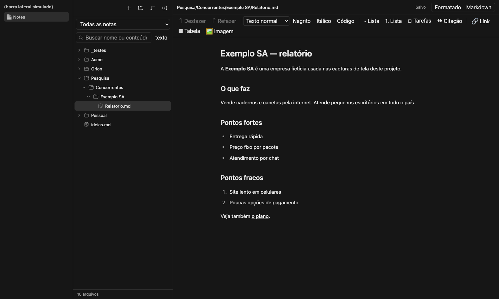

# Notes — plugin do Cloudroom

Mostra na **barra lateral** do Cloudroom a página **Notes**: a árvore de pastas de `~/Notes`
(ou outra pasta que você configurar) e um editor em que você escreve **direto no texto formatado**,
sem precisar saber Markdown. Os arquivos continuam sendo arquivos comuns no disco.

> **Status honesto: beta de uso pessoal (v0.1).** Feito para uso de uma pessoa, em UMA janela/aba e uma nota por vez; testado pelo autor e revisado por modelos de IA (9 rodadas de revisão adversarial) — **não** auditado por terceiros. Com 2 ou mais abas na mesma nota, combinadas com falha de rede/armazenamento, um rascunho ainda não salvo pode se perder. Faça backup das suas notas antes de usar e comece com a opção `readOnly`. Veja "Limites conhecidos" em Segurança e "Limites do projeto".



_As capturas de tela vêm de um cofre de notas **fictício** rodando no harness de testes (SDK simulado), não do app do autor._

## O que tem

- Árvore de pastas (expandir/recolher, ícones, ordenar por nome/mais recentes), busca por nome e por conteúdo.
- **Notas por projeto:** seletor de projeto no topo (`Notes/Orion/…`, `Notes/Acme/…`); abre na pasta do projeto aberto.
- Editor **Formatado** (barra de botões: títulos, negrito, itálico, listas, tarefas, citação, link, tabela, imagem; cole ou arraste imagens) e modo **Markdown** (texto cru).
- Salvamento automático (700 ms), desfazer/refazer, ⌘S.
- `.html` em quadro isolado (SEM scripts e SEM rede, sempre) e imagens.
- Criar, renomear, mover (arrastar) arquivo e pasta.
- **Nunca apaga:** remover = confirmar + mover para `.lixeira` (restaurável pelo botão Lixeira).
- **Conflito:** se o arquivo mudou no disco enquanto você editava → "Manter o meu" (a versão deles vai para `.lixeira/conflitos`) / "Pegar o deles" (o SEU texto vai para `.lixeira/conflitos` antes de ser trocado).
- Antes da primeira gravação de cada edição, a versão anterior é guardada em `.lixeira/versoes`.
- Atualização ao vivo (watcher do sistema + conferência a cada 8 s).
- Comando para agentes: `room-cli notes vaults | list | read | write --expect-hash`, e a skill `notes`.

## Segurança

Plugins do Cloudroom são código de confiança total; este foi feito para ficar preso a uma pasta:

- Todo caminho é resolvido e conferido contra a raiz (`..`, caminho absoluto, `\`, NUL, pastas ocultas e symlink que sai da raiz são recusados — tanto em leitura quanto em escrita, criação, renomeação).
- Sem rede, sem telemetria, sem segredos. Imagens externas em Markdown são bloqueadas.
- HTML sempre em `<iframe sandbox="">` (sem scripts, nunca `allow-same-origin`) com CSP `default-src 'none'`.
- O módulo de arquivos não tem nenhuma operação de apagar conteúdo do usuário (há teste para isso). Remover = confirmar + mover para `.lixeira`. Só se descartam arquivos temporários do próprio plugin.
- Gravação: compara o hash (SHA-256) do que o editor leu com o do disco; se mudou, NÃO grava e pergunta. O hash é conferido de novo imediatamente antes de um `rename` atômico; o arquivo original nunca é movido, e a cópia de segurança (`.lixeira/versoes` na 1ª gravação de cada edição, `.lixeira/conflitos` em "Manter o meu") é um arquivo independente. Mover/restaurar nunca sobrescrevem (link/mkdir exclusivos; se um editor publicar versão nova na origem durante a movimentação, as duas ficam).
- A `.lixeira` e seus subníveis são validados sem seguir links simbólicos. Links simbólicos não são movidos nem removidos; alias para arquivo oculto é recusado.
- Limites conhecidos (inerentes ao Node/POSIX, iguais aos de qualquer editor que salva por troca atômica): (1) outro processo com permissão de escrita pode alterar o arquivo no intervalo entre a última conferência do hash e o `rename` (microssegundos; na 1ª gravação de cada sessão e em "Manter o meu" há uma conferência extra depois da cópia de segurança, que leva alguns milissegundos); (2) uma troca de pasta por link simbólico feita por outro processo exatamente entre a validação e o uso é só reduzida (revalidação), não eliminada; (3) um editor que mantém o arquivo aberto e escreve no inode antigo depois do rename perde essa escrita; (4) ao mover/renomear um ARQUIVO, se outro processo publicar uma versão nova no nome antigo no instante exato entre a conferência final do inode e a remoção desse nome, essa versão nova se perde (o conteúdo movido fica no destino).
- Outros limites do dia a dia: salvar troca o arquivo por um novo, então data de criação, etiquetas do Finder e hardlinks não são preservados (permissão sim; arquivo protegido contra escrita é recusado); o editor Formatado reescreve o bloco que você editou (blocos não tocados ficam idênticos byte a byte) e por isso notas com `[[wikilink]]`, callouts `> [!x]`, rodapé `[^1]` ou `^[x]`, alinhamento de tabela, link com título (`"t"`, `'t'` ou `(t)`), `file://`, matemática `$a*b$` ou cerca de código com atributos abrem só em Markdown (regras em `lib/visual-safety.ts`); `.lixeira/versoes` ganha uma cópia por sessão de edição e não é limpa automaticamente; "Restaurar" de uma cópia de segurança de uma nota que ainda existe devolve ao lado como `nome (versão DATA).md`.
- Rascunho: enquanto houver texto não confirmado em disco, uma cópia fica no navegador (400 ms depois da última alteração, e ao fechar/ocultar a aba); só é apagada quando a gravação é confirmada. É oferecida ao reabrir (a chave inclui o caminho da raiz) e a edição fica bloqueada até você restaurar ou descartar. "Pegar o deles" só troca o texto depois de copiar para `.lixeira/conflitos` exatamente o que está na tela.
- Notas com notas de rodapé (`[^1]`) abrem só em modo Markdown (o editor formatado as quebraria).

## Instalar e configurar

Requer o Cloudroom com suporte a plugins (SDK `@get-bb/plugin-sdk` 0.6.x) e Node.js. Plugins são código de confiança total: leia o código antes de instalar.

```sh
npm install
npm run build              # room-cli plugin build
room-cli plugin install . --yes
room-cli plugin config notes set root ~/Notes        # sem raiz configurada o plugin não toca em nada
room-cli plugin reload notes
```

Modo só leitura (recomendado para começar): `room-cli plugin config notes set readOnly true` (vale ao vivo; o painel mostra aviso e nada é gravado).

Mais pastas: `room-cli plugin config notes set extraVaults $'Orion=/caminho/outra-pasta'` (uma por linha, `Nome=/caminho`).

## Desenvolvimento

```sh
npm test            # testes (vitest): path traversal, symlink, conflito, lixeira, imagens
npm run typecheck
room-cli plugin dev # recompila e recarrega a cada alteração
./harness/seed.sh /tmp/notes-demo   # cria um cofre FICTÍCIO
node harness/build.mjs && NOTES_ROOT=/tmp/notes-demo node harness/dist/run.mjs   # app no navegador com SDK simulado (ver harness/e2e/README.md)
```

`server.ts` (RPC, watcher, CLI) · `lib/notes-fs.ts` (núcleo seguro de arquivos) · `components/visual-editor.tsx` (editor formatado) · `app.tsx` (página).

## Limites do projeto

- Só testado em macOS com Cloudroom local; o Windows/Linux não foi testado.
- Não há testes automatizados de interface no repositório além das capturas (`harness/e2e/captures.mjs`); a lógica de arquivos e segurança tem testes unitários.
- Sem sincronização, sem controle de versão próprio (só as cópias em `.lixeira`), sem criptografia.

